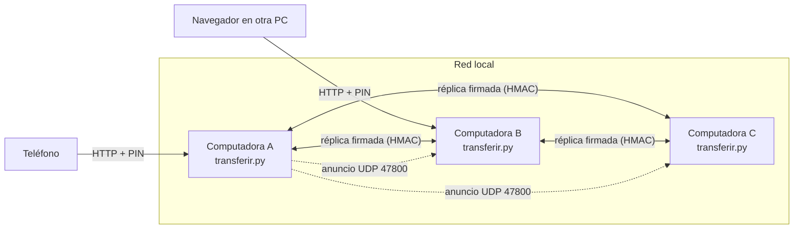

# Transferir

**Carpetas compartidas por el navegador y replicadas entre las computadoras de una red local.**

Transferir convierte las computadoras de una misma red (casa, oficina, escuela) en un pequeño sistema distribuido de
archivos: cada computadora guarda una copia completa de las carpetas compartidas, se sincroniza sola con las demás y
deja entrar desde cualquier teléfono o navegador con un PIN, sin instalar ninguna app.

- Un solo archivo de Python (`transferir.py`), **sin dependencias**: solo Python 3.8 o más nuevo.
- Funciona en **macOS, Windows y Linux**; los teléfonos (Android, iPhone) entran por el navegador.
- Arranca solo al iniciar la sesión.

---

## Contenido

1. [Qué hace](#qué-hace)
2. [Cómo funciona por dentro](#cómo-funciona-por-dentro)
3. [Instalación](#instalación)
4. [Uso diario](#uso-diario)
5. [Agregar otra computadora](#agregar-otra-computadora)
6. [Acceso por SMB (Samba) desde el explorador de archivos](#acceso-por-smb-samba-desde-el-explorador-de-archivos)
7. [Seguridad](#seguridad)
8. [Solución de problemas](#solución-de-problemas)
9. [Desinstalar](#desinstalar)
10. [Guion para la presentación](#guion-para-la-presentación)

---

## Qué hace

| Carpeta | Quién entra | ¿Se replica entre computadoras? | Qué se puede hacer |
|---|---|---|---|
| **Compartida** | Quien tenga el PIN de la compartida | Sí | Subir, bajar, borrar |
| **Personal 1, 2 y 3** | Cada una con su propio PIN | Sí | Subir, bajar, borrar |
| **Este equipo** (Escritorio, Documentos, carpeta de usuario) | PIN de equipo, distinto en cada computadora | No (son demasiado grandes) | Navegar subcarpetas, subir, bajar; **no** borra |

- **Réplica automática:** lo que se sube, cambia o borra en una computadora aparece en las demás en unos 10 segundos.
- **Descubrimiento automático:** las computadoras de la misma red se encuentran solas.
- **Interfaz web:** arrastrar y soltar, barra de progreso, lista que se actualiza sola, pestañas y ruta para navegar
  carpetas. Se adapta a pantallas de teléfono.
- **Arranque automático:** LaunchAgent en macOS, servicio de usuario systemd en Linux, carpeta Inicio en Windows.

## Cómo funciona por dentro



- **Servidor HTTP** (`ThreadingHTTPServer` de la biblioteca estándar) en el puerto 8000: sirve la página, la lista de
  archivos, subidas (`PUT`, escritas a un `.parcial` y renombradas al terminar) y descargas.
- **Descubrimiento:** cada 15 s cada nodo difunde por UDP (puerto 47800) un anuncio con el id de la red, su id y su
  puerto, firmado con HMAC-SHA256. Quien lo recibe y comparte el secreto de la red agrega al nodo.
- **Réplica sin servidor central (*peer-to-peer*):** cada 10 s cada nodo pide a los demás el *manifiesto* de cada
  carpeta (nombre, tamaño y fecha de modificación de cada archivo, más las *lápidas* de los borrados) y descarga lo que
  el otro tenga más nuevo. Gana el cambio más reciente (*last-writer-wins*).
  - Las descargas conservan la fecha original, así que un archivo no "rebota" entre nodos.
  - Los borrados (desde la página o a mano en el disco) se guardan como lápidas para que no regresen desde otro nodo.
- **Autenticación entre nodos:** cada petición lleva hora y firma HMAC del secreto de la red; se rechazan firmas
  inválidas o con más de 5 minutos de diferencia.
- **Autenticación de personas:** PIN de 6 dígitos → galleta de sesión `HttpOnly`/`SameSite=Strict`. Tras 5 intentos
  fallidos desde la misma IP se bloquea 1 minuto.

Archivos que usa en cada computadora:

| Ruta | Contenido |
|---|---|
| `~/Transferencias/` | Carpetas replicadas (Compartida, Personal 1–3) |
| `~/.transferir/config.json` | Secreto de la red, PINs, código de unión, puerto (permisos 600) |
| `~/.transferir/estado.json` | Nodos conocidos, lápidas e índice |
| `~/.transferir/registro.log` | Registro del servicio |
| `~/.transferir/transferir.py` | Copia instalada del programa |

## Instalación

### Requisito: Python 3.8 o más nuevo

| Sistema | Cómo tenerlo |
|---|---|
| macOS | `brew install python` o el instalador de [python.org](https://www.python.org/downloads/) |
| Windows | Instalador de [python.org](https://www.python.org/downloads/windows/) marcando **"Add python.exe to PATH"**, o `winget install Python.Python.3.12` |
| Linux | Ya viene en casi todas las distribuciones (`python3 --version`) |

### Primera computadora (crea la red)

```bash
git clone https://github.com/Minepacman/transferir-archivos.git
cd transferir-archivos
python3 transferir.py --instalar      # en Windows: py transferir.py --instalar
python3 transferir.py --info          # muestra la dirección, los PINs y el código de unión
```

`--instalar` copia el programa a `~/.transferir/`, crea la red (secreto, PINs y código de unión) y lo deja arrancando
solo al iniciar la sesión. Ejemplo de `--info` (los números de cada instalación son distintos):

```
Carpetas en: /Users/ana/Transferencias
Dirección: http://192.168.1.50:8000
PIN Compartida   123456
PIN Personal 1   234567
PIN Personal 2   345678
PIN Personal 3   456789
PIN Este equipo  567890   (Escritorio, Documentos y carpeta de usuario de ESTA computadora)
Código de unión: AbCdEfGh
Computadoras conocidas: 0
```

> **macOS:** la primera vez puede aparecer "¿Permitir que Python acepte conexiones entrantes?": elige **Permitir**.
> Si la página dice que no hay permiso para leer Escritorio o Documentos: Ajustes del Sistema → Privacidad y
> seguridad → Acceso total al disco → agrega el Python que indica el mensaje.
>
> **Windows:** al primer arranque, el Firewall pregunta si Python puede usar la red: marca **Redes privadas** y acepta.

Para probarlo sin instalar: `python3 transferir.py` (se detiene con Ctrl+C).
Para otro puerto: `python3 transferir.py --puerto 9000` (se guarda en la configuración).

## Uso diario

1. En el teléfono o en cualquier navegador de la red abre la dirección (por ejemplo `http://192.168.1.50:8000`).
2. Escribe el PIN de la carpeta a la que quieres entrar.
3. **Subir:** arrastra archivos al recuadro o tócalo para elegirlos (se pueden varios a la vez).
4. **Bajar:** toca el nombre del archivo.
5. **Borrar** (solo en Compartida y Personales): botón *Borrar*; también se borra en las demás computadoras.
6. Con el **PIN de equipo** aparecen pestañas *Compartida · Escritorio · Documentos · Carpeta de usuario*; toca una
   carpeta para entrar y usa la ruta de arriba para regresar.
7. **Salir** cierra la sesión en ese navegador (si no, dura 30 días).

Si un archivo ya existe con el mismo nombre, el nuevo se guarda como `nombre (1).ext`; nunca se sobrescribe nada.

## Agregar otra computadora

En la computadora nueva (con Python instalado):

1. Abre la dirección de una computadora de la red, entra con el **PIN de equipo** y en
   *"Agregar otra computadora a la red"* descarga `transferir.py` (o clona este repositorio).
2. Ejecuta, con el código de unión que muestra `--info` en la primera computadora:

   ```bash
   python3 transferir.py --unirse http://192.168.1.50:8000 --clave AbCdEfGh
   ```

La computadora nueva recibe el secreto de la red y los PINs, se instala con arranque automático, descarga las carpetas
replicadas y desde ese momento cualquier cambio en una se ve en todas. Tiene **su propio PIN de equipo** (míralo con
`--info` en ella).

## Acceso por SMB (Samba) desde el explorador de archivos

Además de la página web, las computadoras pueden abrir las carpetas en Finder/Explorador por SMB, el protocolo de
archivos de red de Windows que también hablan macOS y Linux (Samba). Se entra con la cuenta del sistema.

**macOS (servidor):**
1. Ajustes del Sistema → General → Compartir → activa **Compartir archivos**.
2. En **(i) → Opciones…** marca **Compartir archivos con Windows** y activa tu cuenta.
3. Para compartir también las carpetas replicadas: `sudo sharing -a ~/Transferencias -S Transferencias`

**Windows (servidor):** clic derecho en `%USERPROFILE%\Transferencias` → Propiedades → Compartir.

**Linux (servidor):** instala Samba (`sudo apt install samba`) y agrega a `/etc/samba/smb.conf`:

```ini
[Transferencias]
   path = /home/TU_USUARIO/Transferencias
   read only = no
   valid users = TU_USUARIO
```

luego `sudo smbpasswd -a TU_USUARIO && sudo systemctl restart smbd`.

**Conectarse:** Mac → Finder → Ir → Conectarse al servidor → `smb://IP`; Windows → `\\IP` en el Explorador;
Linux → `smb://IP` en el gestor de archivos.

## Seguridad

Pensado para **redes de confianza** (casa, oficina, salón):

- El tráfico va por **HTTP sin cifrar**: alguien en la misma red podría ver los archivos que pasan. No usar en Wi-Fi
  públicas.
- El **PIN de equipo** abre tu carpeta de usuario completa (bajar y subir, sin borrar): no lo compartas.
- El **código de unión** permite agregar computadoras, que reciben copia de **todas** las carpetas replicadas,
  incluidas las personales. Trátalo como una contraseña.
- Lo que sí protege: PINs de 6 dígitos con bloqueo por intentos, sesiones `HttpOnly`, nombres de archivo saneados
  (nada de `../` ni rutas absolutas), rutas resueltas para que un enlace simbólico no salga de la carpeta, archivos
  ocultos invisibles, mensajes entre nodos firmados con HMAC-SHA256 y con caducidad de 5 minutos.

## Solución de problemas

| Síntoma | Qué revisar |
|---|---|
| El teléfono no abre la página | Que esté en la misma Wi-Fi; que la dirección sea la de `--info`; el firewall (macOS: Ajustes → Red → Firewall; Windows: permitir Python en redes privadas) |
| "Address already in use" en el registro | Otro programa usa el puerto 8000: `python3 transferir.py --puerto 9000` |
| Las computadoras no se ven entre sí | La red puede bloquear la difusión UDP; se conocen igual al unirse con `--unirse` y por las peticiones entre ellas. Revisa `--info` → "Computadoras conocidas" |
| "Esta computadora no dio permiso para leer esa carpeta" | macOS: dar Acceso total al disco al Python indicado |
| Un archivo no aparece en la otra computadora | Espera ~10 s; revisa `~/.transferir/registro.log` en ambas |
| Olvidé los PINs | `python3 ~/.transferir/transferir.py --info` |

## Desinstalar

```bash
python3 ~/.transferir/transferir.py --desinstalar
```

Quita el arranque automático. Los archivos (`~/Transferencias`) y la configuración (`~/.transferir`) se quedan; bórralos a
mano si ya no los quieres.

## Guion para la presentación

Demostración de unos 10 minutos con dos computadoras y un teléfono en la misma Wi-Fi.

1. **El problema (1 min).** Pasar archivos entre teléfono y computadoras de la misma casa u oficina sin cables, sin
   nube y sin instalar apps.
2. **La idea (1 min).** Cada computadora es un nodo igual a los demás (*peer-to-peer*): guarda una copia completa y se
   sincroniza con las otras; los teléfonos solo necesitan un navegador. Mostrar el diagrama de
   [Cómo funciona por dentro](#cómo-funciona-por-dentro).
3. **Instalar la primera computadora (1 min).** `python3 transferir.py --instalar` y `--info`: dirección y PINs.
4. **Teléfono (2 min).** Abrir la dirección, PIN de la Compartida, subir una foto. Aparece en la lista al instante.
5. **Unir la segunda computadora (2 min).** `python3 transferir.py --unirse http://IP:8000 --clave …`. Abrir
   `~/Transferencias/Compartida` en ella: la foto ya está ahí (réplica).
6. **Réplica en ambos sentidos y borrado (1 min).** Copiar un archivo a mano en la carpeta de la segunda
   computadora → aparece en el teléfono. Borrarlo desde el teléfono → desaparece en las dos.
7. **Carpetas personales y PIN de equipo (1 min).** Entrar con un PIN personal: solo se ve esa carpeta. Entrar con el
   PIN de equipo: pestañas de Escritorio y Documentos, navegar y bajar un archivo.
8. **Tolerancia a fallos (1 min).** Apagar el Wi-Fi de una computadora, hacer cambios en la otra, volver a conectar:
   en unos segundos se pone al día. Reiniciar una: arranca sola.
9. **Cierre.** Sin dependencias, un archivo, multiplataforma. Límites y siguientes pasos: HTTPS, conflictos con
   versiones (hoy gana el más reciente), cifrado de las carpetas personales.

### Conceptos de sistemas distribuidos que se ven

| Concepto | Dónde aparece |
|---|---|
| Arquitectura *peer-to-peer* (sin servidor central) | Todos los nodos corren el mismo programa y se replican entre sí |
| Descubrimiento de servicios | Anuncios UDP por difusión en el puerto 47800 |
| Replicación optimista / consistencia eventual | Cada nodo acepta cambios localmente y converge en segundos |
| Resolución de conflictos *last-writer-wins* | Gana la fecha de modificación más reciente |
| Lápidas (*tombstones*) | Los borrados se propagan y no "resucitan" |
| Autenticación de mensajes | HMAC-SHA256 con secreto compartido y ventana de tiempo |
| Tolerancia a fallos | Un nodo caído no detiene a los demás y se pone al día al volver |

---

Autor: Elias Oziel Sánchez Fernández.
